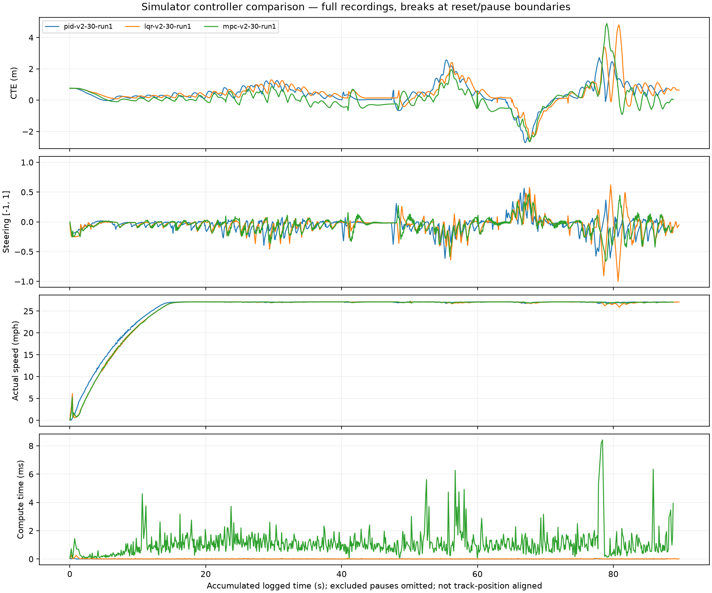
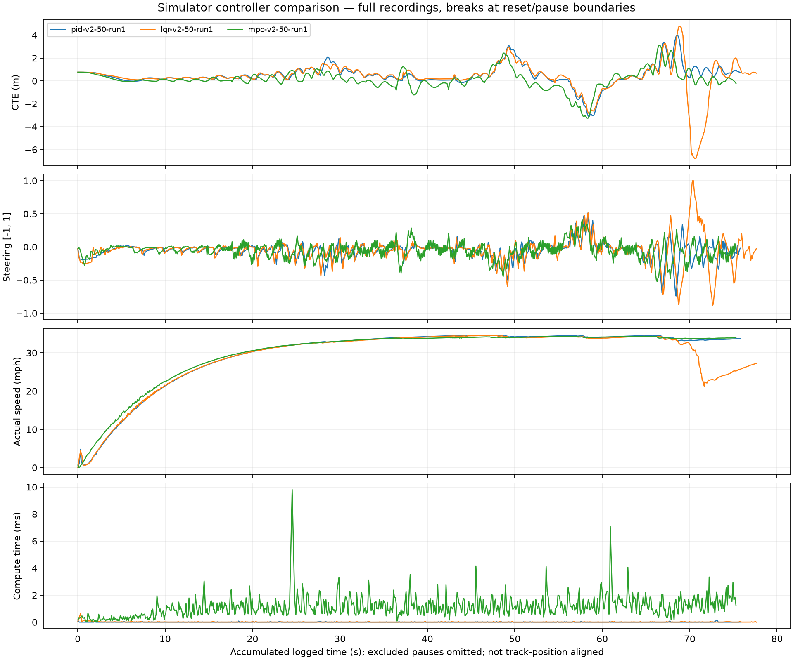

# Simulator results through 2026-10-31

This records the Ubuntu 22.04.5 simulator experiments before further controller or
speed-control changes. PID/LQR v2 were published in commit `2d5fa40`; MPC v2 was
introduced in `42eadb5` and remained unchanged during the PID/LQR revision. CSVs do
not embed a Git revision, so version attribution follows the experiment history and
filenames rather than independently recorded binary provenance.

## Conclusions

- PID v2 is a competitive, low-computation baseline. At the 30 mph target its RMS
  tracking error nearly matches MPC, with a smaller worst excursion and lower
  commanded steering-rate RMS.
- LQR v2 reduces overall steering activity but still has large excursions. At the
  50 mph target it left the track near the end, recovered, and completed the lap.
  This is a completed lap with a track departure, not a successful stay-on-track test.
- MPC v2 has the lowest RMS and maximum tracking errors in the higher-speed recordings,
  although it uses more steering activity and computation there.
- These observations compare our tuned implementations. They do not establish a
  universal ranking of PID, LQR, and MPC. PID v2 includes model-based prediction.

## Lap outcomes

Outcomes come from the driver's reports, not automatic detection in the CSVs.

| Controller | Target (mph) | Reported outcome |
| --- | ---: | --- |
| MPC v1 | Initial test | Failed to finish the lap |
| MPC v2 | 15, 25, 30, 50 | Completed laps |
| PID v2 | 30, 50 | Completed; no departure reported |
| LQR v2 | 30 | Completed; no departure reported |
| LQR v2 | 50 | Left the track near the end, recovered, and completed |

The original comparison PID at 25 mph was subsequently reported to have left the
track. Original PID and LQR at 30 mph completed with substantial oscillation.
Those comparison baselines are distinct from the six-year-old legacy submission.

## Measured results

Each row covers its full recording, including acceleration and any recovery.
CTE is lateral tracking error. RMS error, mean speed, and steering-rate RMS are
weighted by logged elapsed time. Steering rate is normalized command units/second,
not wheel angle or a direct measurement of ride comfort. Lower error is better;
lower steering activity alone does not establish better tracking.

| Target mph | Controller | RMS CTE m | Max absolute CTE m | Steering-rate RMS /s | Mean actual mph | Peak actual mph |
| ---: | --- | ---: | ---: | ---: | ---: | ---: |
| 30 | PID v1 | 0.888 | 3.772 | 1.403 | 24.979 | 27.085 |
| 30 | LQR v1 | 0.934 | 3.374 | 1.284 | 24.614 | 27.116 |
| 30 | PID v2 | 0.830 | 2.722 | 0.583 | 25.372 | 27.121 |
| 30 | LQR v2 | 0.896 | 4.812 | 0.691 | 25.157 | 27.283 |
| 30 | MPC v2 | 0.821 | 4.896 | 0.663 | 25.165 | 27.216 |
| 50 | PID v2 | 1.007 | 4.002 | 0.648 | 29.809 | 34.614 |
| 50 | LQR v2 | 1.366 | 6.799 | 0.757 | 29.037 | 34.560 |
| 50 | MPC v2 | 0.846 | 3.261 | 1.004 | 30.030 | 34.322 |

At the 30 mph target, PID v2 reduced steering-rate RMS by approximately 58%, RMS
error by 7%, and maximum error by 28% relative to PID v1. LQR v2 reduced steering-rate
RMS by 46% and RMS error by 4%, but its maximum error increased by 43%.

At the 50 mph target, MPC's RMS error is approximately 16% below PID's and 38% below
LQR's. LQR's largest absolute excursion occurs around 70.6 seconds of accumulated
logged time and accompanies a subsequent speed drop. The driver confirmed a track
departure and recovery. No track width is inferred from the CTE values alone.

## Target speed is not achieved speed

The 50 mph-target runs peaked at only 34.3–34.6 mph. All their logged throttle values
were at the shared +0.3 limit. The shared proportional speed controller is:

```text
throttle = clamp(0.08 * (target_mph - measured_mph), -0.3, 0.3)
```

The observed plateau and capped throttle mean these runs do not demonstrate control
at an actual 50 mph. The 30 mph-target runs plateau near 27 mph. Changing speed control
will change the experiment for every lateral controller and should be evaluated as
a separate revision. Do not compare target labels as if they were measured speeds.

## Timing and computation

| Target mph | Controller | Median telemetry interval ms | Mean controller computation ms |
| ---: | --- | ---: | ---: |
| 30 | PID v1 | 141.5 | See original log; multiple segments |
| 30 | LQR v1 | 116.9 | 0.0023 |
| 30 | PID v2 | 64.1 | 0.0035 |
| 30 | LQR v2 | 63.1 | 0.0093 |
| 30 | MPC v2 | 79.4 | 0.9966 |
| 50 | PID v2 | 68.0 | 0.0044 |
| 50 | LQR v2 | 67.8 | 0.0104 |
| 50 | MPC v2 | 81.8 | 1.0569 |

The user reported a sluggish computer during earlier runs. New PID/LQR recordings
have substantially shorter telemetry intervals. That confounds before/after results:
we cannot attribute the entire improvement to controller changes. These logs contain
wall-clock intervals, not simulator timestamps, and do not identify whether graphics,
CPU load, or simulation-time scaling caused timing differences. Mean MPC computation
is much shorter than its telemetry interval; that does not identify the remaining delay.

## Plots

The traces below use accumulated logged time, not matched track position. Curves
must not be interpreted as exact same-location comparisons. Excluded long pauses
are omitted; startup and recovery remain included.





## Sources, method, and reproducibility

The following local files supplied the numeric results, in table order:

1. `outputs/pid-30-run1.csv`
2. `outputs/lqr-30-run1.csv`
3. `outputs/pid-v2-30-run1.csv`
4. `outputs/lqr-v2-30-run1.csv`
5. `outputs/mpc-v2-30-run1.csv`
6. `outputs/pid-v2-50-run1.csv`
7. `outputs/lqr-v2-50-run1.csv`
8. `outputs/mpc-v2-50-run1.csv`

Raw recordings remain local under the existing ignored `outputs/` directory. This
report and the two selected plots are versioned so GitHub readers can inspect the
results; raw-data reproduction requires obtaining the listed recordings separately.

`scripts/plot_runs.py` computes full-recording metrics. It excludes command differences
across segment boundaries when calculating steering-rate RMS. PID v1 at 30 mph has
four segments; the other listed runs each have one. A segment boundary is not proof
of a simulator reset. `scripts/summarize_run.py` reports individual segments instead.

For samples with interval dt, CTE e, and steering u:

```text
CTE RMS = sqrt(sum(e^2 * dt) / sum(dt))
steering-rate RMS = sqrt(sum((u_i-u_previous)^2 / dt_i) / sum(dt))
mean speed = sum(speed * dt) / sum(dt)
```

Only within-segment differences enter the steering-rate numerator. Peak speed and
maximum absolute CTE are sample maxima. Computation time is an unweighted sample
mean. With the local recordings, recreate the plots in new output directories:

```bash
python3 scripts/plot_runs.py outputs/pid-v2-30-run1.csv outputs/lqr-v2-30-run1.csv outputs/mpc-v2-30-run1.csv --out outputs/results-30-repeat
python3 scripts/plot_runs.py outputs/pid-v2-50-run1.csv outputs/lqr-v2-50-run1.csv outputs/mpc-v2-50-run1.csv --out outputs/results-50-repeat
```

## What remains uncertain and what comes next

These are individual recordings, not repeated trials with confidence intervals.
They differ in duration, timing, and potentially runtime conditions. Lap completion
and departures rely on driver reports. Synthetic tests are development checks, not
substitutes for simulator laps. Five Windows numerical/protocol test suites passed
before publication of PID/LQR v2; Ubuntu builds/tests and driving were user-verified.

Before claiming repeatable superiority, repeat each controller under consistent
settings and record departures as well as completion. Investigate LQR's late excursion
while keeping PID/MPC as references. Then improve the shared speed controller as a
separate experiment and increase actual speeds gradually. No controller or throttle
changes are included in this documentation checkpoint.
